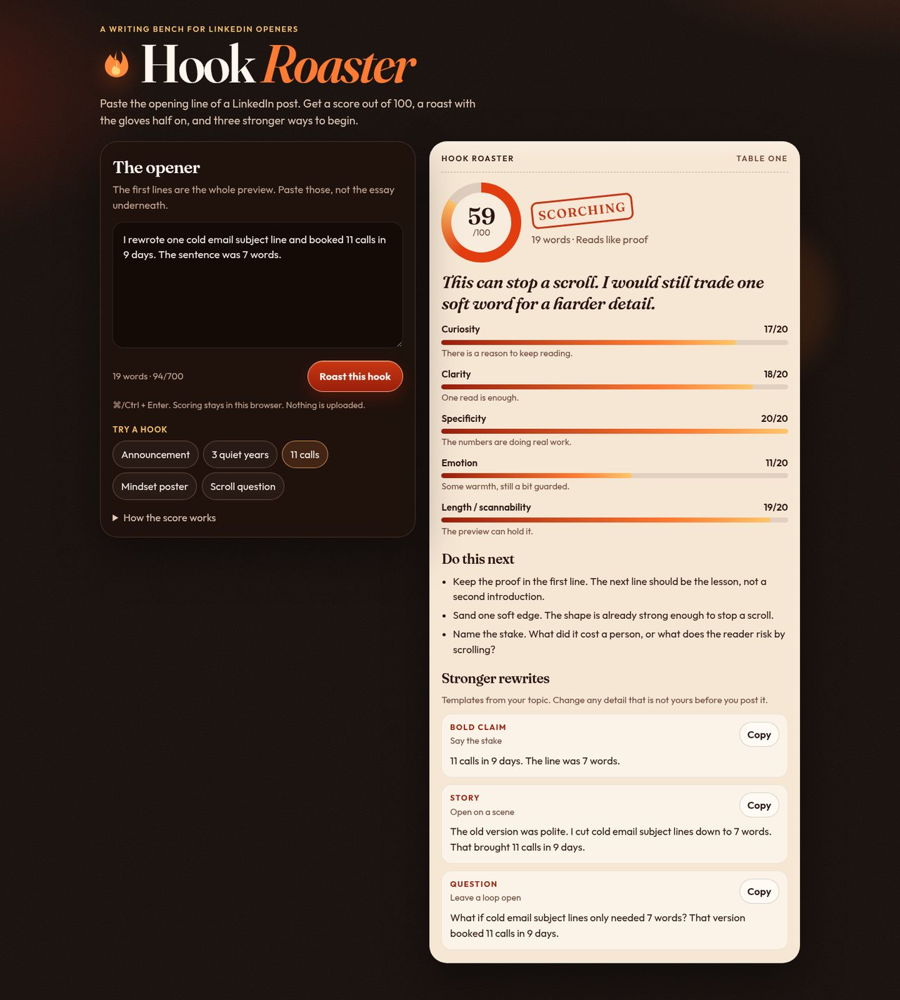

# Hook Roaster

Paste the opening line of a LinkedIn post. Hook Roaster scores it out of 100, writes a short roast, and offers three stronger ways to begin.

**Live site:** [https://taha080.github.io/hook-roaster/](https://taha080.github.io/hook-roaster/)



## What it is

Hook Roaster is a static page for judging the first lines of a LinkedIn post. The page you open is the whole application. It runs in the browser, asks for no account, and calls no API. Text you paste stays on your machine.

The page is a writing tool by [Taha Ahsan](https://www.linkedin.com/in/taha-ahsan-832475270/). The repository is [github.com/taha080/hook-roaster](https://github.com/taha080/hook-roaster).

## Features

- A score from 0 to 100 and a verdict: Needs fire, Simmering, Solid heat, Scorching, or Untouchable
- Five meters, each scored from 0 to 20: Curiosity, Clarity, Specificity, Emotion, and Length / scannability, each with a one-line note
- A roast that follows the weakest signal, or a warmer line when the score is already high
- Up to three tips aimed at what that draft is missing
- Three rewrites — Bold claim, Story, and Question — each with its own Copy button
- Five example hooks you can load in one click
- A live word count and a character count, with a 700-character limit
- Command+Enter, or Ctrl+Enter, to roast the draft
- A two-column layout that stacks into one column on narrow screens

## How it works

`index.html` is the page. `js/engine.js` scores the text and writes the rewrites. `js/app.js` connects the form, the example buttons, and the result panel. `css/styles.css` is the layout. Fraunces and Outfit ship in `fonts/`, so the page does not request fonts from another site.

There is no build step. In the browser, the engine is `window.HookRoaster`. The same file exports `roast` and `EXAMPLES` for Node, which is how the tests load it.

`roast` trims the draft and normalizes curly quotes and dashes. A blank draft stops there and returns the error “Paste an opening line first. Even a bad one roasts well.” The box then shakes. Anything else is read for:

- words, lines, questions, numbers, currency, and percents
- hard clichés such as “excited to announce”, “believe in yourself”, and “let that sink in”
- filler (“just”, “really”, “very”), buzzwords, curiosity words, emotion words, vague words, and concrete nouns such as “subject line” or “calls”
- a topic from a fixed list (leadership, cold email, hiring, and others)
- a role, when the draft says “position as …” or “started as …”, including a company after “at”
- a kind: announcement, hiring note, proof, question, advice, or a general opener

Each signal starts from a small baseline, moves up or down, and is clamped between 0 and 20. The total is the sum of the five scores.

| Signal | What moves it |
| --- | --- |
| Curiosity | A real question, contrast such as “but” or “then”, words such as “nobody” or “mistake”, and numbers. Clichés pull it down. A trailing “thoughts?” or “agree?” is a weak question. |
| Clarity | Short sentences. Long sentences, filler, buzzwords, and a draft over 80 words pull it down. |
| Specificity | Numbers, dates, a named role, and concrete objects. Vague words such as “growth” and “mindset” pull it down. |
| Emotion | Feeling words, a first-person stake, and “you” or “your”. Stock excitement attached to a cliché pulls it down. |
| Length / scannability | About 10–32 words scores best. At most 190 characters (with at least 8 words) adds points; more than 340 characters subtracts. Two or three non-empty lines add points. So does a draft of two or more sentences when each sentence is 22 words or fewer. All caps, extra exclamation marks, more than three emoji, and a very short or very long draft pull it down. |

Verdicts use the total: 90–100 Untouchable, 75–89 Scorching, 58–74 Solid heat, 38–57 Simmering, and 0–37 Needs fire. The score dial uses those 75 and 38 cutoffs too: 75 and above, 38–74, and below 38.

The roast is one of two lines for that case. A hash of the text picks the line, so the same draft always gets the same roast. Under five words, the roast says the line is too thin. A clichéd draft scoring under 68 gets a cliché roast. A score of 88 or above uses the strongest praise. A score from 74 to 87 uses the milder pair. Every other draft is roasted on its lowest meter. Ties break in this order: curiosity, specificity, emotion, clarity, then length.

Tips stop at three. They name clichés in the draft, ask you to move a number that starts at character 150 or later, flag a line of capitals, flag extra exclamation marks, and ask for “you” or “your” on advice and questions. Remaining slots go to any meter under 15. If the list is still short, the last candidate is a reminder to read the line out loud.

Rewrites are templates filled with the topic, role, and number phrases found in the opener. A draft under five words gets a generic trio. After that, hiring notes, announcements, proof lines, and questions each use their own templates. Advice, and any remaining draft that contains a cliché, can use a fixed set of lines for mindset, leadership, personal growth, productivity, content, or hooks when one of those topics is present. Where two phrasings exist, the same text hash picks one, so a repeat roast matches the first. Each card is labeled Bold claim (“Say the stake”), Story (“Open on a scene”), or Question (“Leave a loop open”). Change any scene so the story is yours before you post it.

Copy uses the Clipboard API. If that call fails, the button falls back to a hidden textarea and `document.execCommand("copy")`, then shows “Copied” for 1.6 seconds. Use the local server or the live site for Copy. The Clipboard API is available on `http://localhost` and on HTTPS.

Results are inserted with `textContent`. A draft that contains HTML tags is shown as text. The engine also accepts a `<script>` string without throwing. The scripts do not store the draft and do not send it anywhere.

On screens 900px wide or narrower, a successful roast scrolls the result into view. If the browser requests reduced motion, the score appears at once, the scroll is instant, and the stylesheet turns off animation.

## Setup and run locally

`package.json` lists no dependencies. Nothing to install.

From the repository root, Python 3 serves the folder:

```bash
python3 -m http.server 4173
```

`npm start` runs that same command. Open [http://localhost:4173](http://localhost:4173).

Tests need Node.js, and they do not install packages:

```bash
npm test
```

That runs `node tests/engine.test.js`.

### Publishing

Pushes to `main`, and manual runs, trigger [`.github/workflows/pages.yml`](.github/workflows/pages.yml). The workflow copies `index.html`, `.nojekyll`, `css`, `js`, `fonts`, and `assets`, then deploys that folder with GitHub Actions. The first time, set **Settings → Pages → Build and deployment → Source** to **GitHub Actions**. The published site is [https://taha080.github.io/hook-roaster/](https://taha080.github.io/hook-roaster/).

## Usage

1. Paste the opening lines, not the rest of the post. The box holds 700 characters. The counter under it shows words and `characters/700`. Past 220 characters the counter turns gold. That color is visual. The length score uses the rules above.
2. Click **Roast this hook**, or press Command+Enter or Ctrl+Enter.
3. Read the dial, the verdict, the roast, the five meters, the tips under “Do this next”, and the three rewrites.
4. Copy a rewrite and edit any detail that is not yours.

**Try a hook** loads one of five samples and roasts it immediately:

| Button | Opens on |
| --- | --- |
| Announcement | “Excited to announce…” leadership and personal growth |
| 3 quiet years | Three years of unread LinkedIn posts |
| 11 calls | A cold-email subject line, 11 calls in 9 days |
| Mindset poster | “Success is all about mindset…” |
| Scroll question | “What if your content is fine and your hook is the reason people scroll?” |

Typing in the box clears the selected example. A `demo` query loads one on arrival: `?demo=announce`, `?demo=years`, `?demo=calls`, `?demo=mindset`, or `?demo=scroll`. Any other value loads the “11 calls” example.

JavaScript is required. With it disabled, the page says: “Hook Roaster needs JavaScript. It still runs entirely in your browser.”

## Project structure

```text
index.html                    Page, form, and result markup
css/styles.css                Layout and the dark ember theme
js/engine.js                  Scoring, tips, and rewrites
js/app.js                     Form, examples, score animation, and copy
tests/engine.test.js          Checks for the scoring engine
assets/favicon.svg            Flame icon
assets/preview.jpg            Social preview image
fonts/                        Fraunces and Outfit
fonts/OFL.txt                 Font license
.github/workflows/pages.yml   GitHub Pages deploy
.nojekyll                     Skips Jekyll on GitHub Pages
package.json                  npm test and npm start
.gitignore                    Ignores .DS_Store, _site/, and node_modules/
```

## Tests

`npm test` runs `tests/engine.test.js` with Node’s `assert` module. The file prints each sample, then “All tests passed.”

It roasts eight drafts: the five examples, “Leadership is about empowering people…”, “Excited to announce that I started a new position as Marketing Manager at Acme!”, and “Hi”. For each one it checks that:

- the report succeeds and the score is between 0 and 100
- each meter is between 0 and 20, and the five meters add up to the total
- the rewrites are Bold claim, Story, and Question, all different, each ending in `.`, `!`, or `?`, each longer than 24 characters, and each at most 60 words
- there are exactly three tips
- roasting the same text again returns the same score, the same roast, and the same first rewrite

It also checks relative scores and a few lines of output. “11 calls” scores at least 80, above the “3 years” story. That story scores above the scroll question. The question scores above both the announcement and the mindset poster. The announcement stays at or below 55, the mindset line at or below 50, and “Hi” at or below 35. “11 calls” scores more than 30 points above the announcement. The “11 calls” rewrites include the phrases “11 calls” and “7 words”. One “3 years” rewrite mentions “3 years”. The bold announcement rewrite does not start with “Excited to announce”. The role sample is classified as an announcement, and a rewrite names Marketing Manager and Acme. A mindset rewrite mentions Monday, a meeting, or the first sentence. The scroll question’s bold claim starts “Your content is fine.”

Two further pairs check the meters: a line with “you” scores higher on emotion than a similar line without it, and “4 clients” scores higher on specificity than “some clients”. A long lead-in before “40%” produces the tip about the first 150 characters. Whitespace-only input fails. A draft that contains `<script>alert(1)</script>` does not throw.

## License

This repository does not include a license for the application code, and `package.json` does not name one. The font files are Fraunces (copyright 2018, The Fraunces Project Authors) and Outfit (copyright 2021, The Outfit Project Authors), under the SIL Open Font License, Version 1.1. The full text is in [`fonts/OFL.txt`](fonts/OFL.txt).
